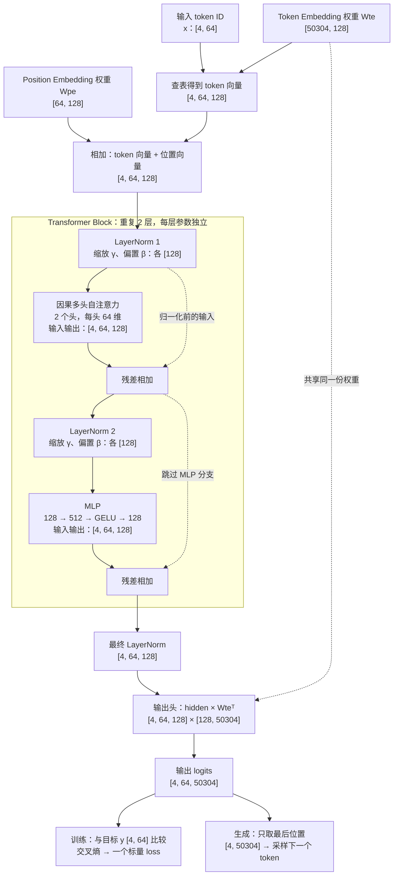

# Mini GPT-2 冒烟测试设计

日期：2026-08-15

## 约定
| 当前符号 | 含义 | 推荐的写法 |
|---|---|---|
| `B` | batch size | `B` 或 `batch_size` |
| `T` | 序列长度 | `T` 或 `seq_len` |
| `V` | 词表大小 | `V` 或 `vocab_size` |
| `C` | hidden dimension | `d_model` |
| `L` | Transformer 层数 | `n_layer` 或 `N_L` |
| `H` | attention 头数 | `n_head` 或 `N_H` |
| `D` | 每个 attention head 的维度 | `d_head` |

其中：

$$
d_{\text{head}} = \frac{d_{\text{model}}}{n_{\text{head}}}
$$



## 目标

在 `mini_gpt2/` 下新增一条独立的小规模 GPT-2 训练路径，用于在约 2–5 分钟内验证完整的本地训练流程。现有项目文件保持不变。

这是工程冒烟测试，而不是对 OpenAI GPT-2 124M 的统计性复现。成功意味着 GPT-2 风格的训练、评估、检查点保存与重新加载，以及自回归生成均可在本地正常运行。

## 文件与边界

所有新增实现和生成产物都放在 `mini_gpt2/` 下：

- `mini_gpt2/train.py`：模型、数据加载器、训练循环、评估、检查点重新加载校验和文本生成。
- `mini_gpt2/README.md`：准确的运行命令、预期输出和结果解读。
- `mini_gpt2/.gitignore`：忽略生成的 `out/` 目录。
- `mini_gpt2/out/model.pt`：生成的检查点，不提交到版本库。

脚本读取仓库根目录中已有的 `input.txt`，但不会修改或复制它。不会编辑任何现有源码或配置文件。

## 模型

模型保留 GPT-2 的核心架构特征：

- 仅解码器 Transformer；
- 可学习的 token 嵌入和位置嵌入；
- 采用前置层归一化的残差块；
- 因果多头自注意力；
- 具有 4 倍扩展维度的 GELU MLP；
- token 嵌入与语言模型输出头共享权重；
- GPT-2 分词器，以及填充后的 50,304 词表大小。

冒烟测试的默认参数：

- 2 层；
- 2 个注意力头；
- 嵌入宽度 128；
- 上下文长度 64；
- batch size 为 4；
- 100 个优化步骤。

模型约有 700 万个参数。通过 CLI 参数可以覆盖训练步数、batch size、序列长度、学习率和设备，无需编辑文件。

## 数据流

使用 `tiktoken` 的 GPT-2 编码对 `input.txt` 进行分词。token 流以确定性方式划分为 90% 的训练数据和 10% 的验证数据。每个 batch 使用带固定种子的 PyTorch 随机数生成器，采样连续的下一 token 预测窗口。

脚本基于仓库位置解析 `input.txt`，因此从仓库根目录或 `mini_gpt2/` 目录启动均可正常运行。

## 运行时行为

使用 `--device auto` 时，设备选择顺序为 CUDA、MPS、CPU。CUDA 在支持时可以使用 bfloat16 自动混合精度；MPS 和 CPU 使用 float32，以避免特定后端的自动混合精度问题。

一次运行包含以下阶段：

1. 输出环境、设备、模型配置、参数量和 token 数量。
2. 以确定性方式评估初始训练损失和验证损失。
3. 按配置的步数训练，并定期输出损失、耗时和 token 吞吐率。
4. 评估最终训练损失和验证损失。
5. 将模型权重、配置、优化步骤、损失和随机种子保存到 `mini_gpt2/out/model.pt`。
6. 将检查点加载到一个新模型中，并在固定验证 batch 上比较 logits。
7. 使用固定提示词和随机种子生成一小段文本。
8. 输出最终的 PASS/FAIL 汇总；失败时返回非零退出状态。

## 验收标准

默认冒烟测试只有在以下条件全部满足时才算通过：

- 初始和最终损失均为有限数值；
- 固定训练探针的最终损失低于初始损失；
- 最终验证损失低于初始验证损失；
- 重新加载检查点后的 logits 与保存前的 logits 匹配，最大绝对误差不超过 `1e-5`；
- 生成的 token ID 始终在词表范围内，且生成结果达到要求的长度；
- 检查点存在并可正常读取。

README 将说明：仅训练 100 步后，生成文本的质量可能仍然较差；对于这个微型模型，HellaSwag 也不具备参考意义。损失下降和检查点等价性是此冒烟测试的权威判断信号。

## 错误处理

当 `input.txt` 缺失、token 数量不足、显式指定的设备不可用、损失不是有限数值、检查点重新加载不一致或未满足验收标准时，脚本会报告清晰的错误。如果用户明确指定 CUDA 或 MPS，脚本不会静默回退到其他设备。

## 验证命令

从仓库根目录运行的主要命令：

```bash
.venv/bin/python mini_gpt2/train.py
```

兼容 CPU 的快速诊断命令：

```bash
.venv/bin/python mini_gpt2/train.py --device cpu --steps 10
```

实现验证将包括语法编译、CLI 帮助信息检查、短时诊断运行，以及在执行环境中可用的最佳设备上运行默认冒烟测试。
